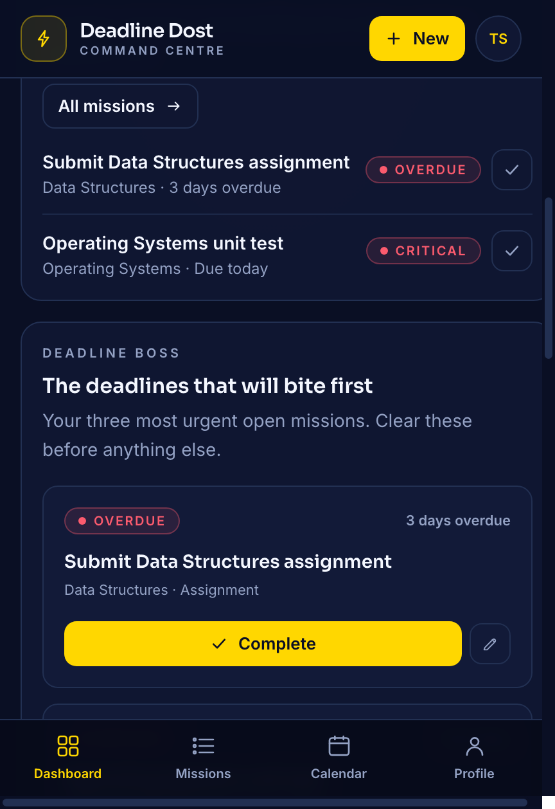
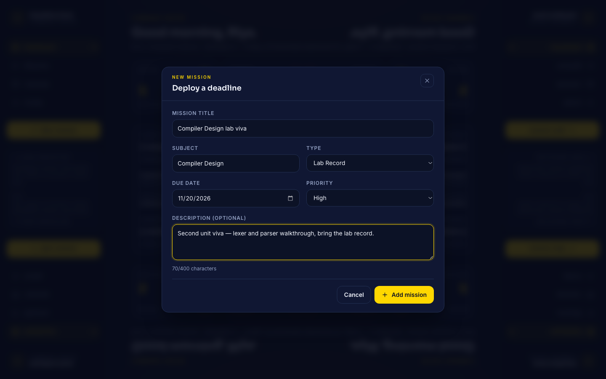
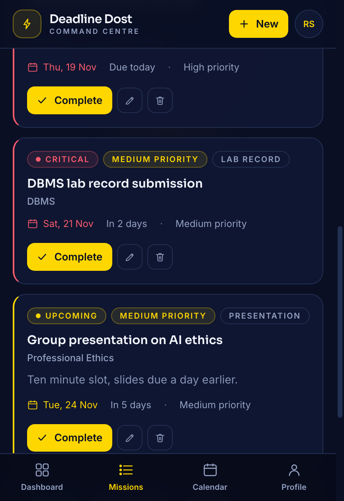
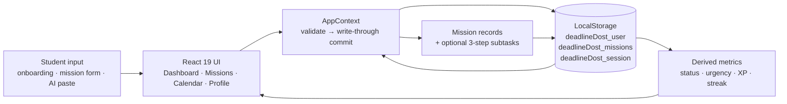
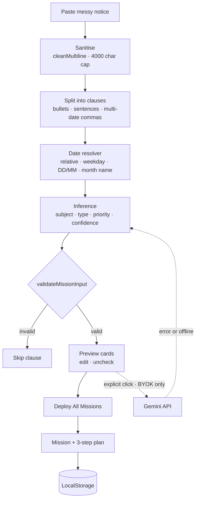

# Deadline Dost

### Your student deadline command centre — private, offline-first, and now AI-assisted.

[](https://deadline-dost-e23izcuvs-savio-chacko-xavier.vercel.app)
[](https://react.dev)
[](https://vite.dev)
[](https://tailwindcss.com)
[](https://vitest.dev)
[]()
[](./LICENSE)

**[Open the live app →](https://deadline-dost-e23izcuvs-savio-chacko-xavier.vercel.app)**

---

## What is Deadline Dost?

Deadline Dost is a **local-first academic deadline command centre** for college
students. You add assignments, exams, lab records, projects and presentations
once; the app turns them into a live command centre with a deadline-pressure
meter, a calendar, XP, levels and streaks.

Everything is stored in your browser's LocalStorage. No sign-up, no cloud
account, no server, no telemetry. Open the tab and it works — even offline.

**Level 3 adds an AI Mission Parser & Tactical Micro-Planner:** paste the chaotic
9:41 pm class-group message, and Deadline Dost splits it into structured,
prioritised missions with a three-step execution plan — running entirely in
JavaScript on your device.

### Core purpose

> Stop losing marks to deadlines you *knew about* but never wrote down properly.

Most students do not have a planning problem; they have a **capture** problem.
The notice arrives as a WhatsApp forward, a spoken announcement, a PDF nobody
opens. Deadline Dost closes that gap in seconds and then keeps the deadline
visible until it is done.

| | |
| --- | --- |
| **Private by default** | Zero accounts, zero network calls, zero telemetry |
| **Student-native** | Lab records, unit tests, vivas, submissions — not generic "tasks" |
| **Honest pressure** | Urgency meter weighted by overdue / 0–2 days / 3–7 days |
| **Motivation without farming** | 100 XP per mission, awarded once, sticky through reopen |
| **Fast capture** | Quick add, full editor, and AI Magic Paste from a messy notice |
| **Actually actionable** | 3-step tactical micro-plans with time boxes per mission |

---

## Visual showcase

### 1. The Command Centre (Dashboard)



The dashboard is the single screen you open in the morning. It shows active,
overdue, due-in-7-days, completed and streak counts; **Today's focus** lists
everything overdue or due today; the **Deadline boss** cards surface the three
most urgent open missions with one-tap complete. The right rail carries XP and
level progress, the urgency meter with its exact weighting, and a short "signal
check" explaining why the numbers move.

### 2. Mission Editor & AI Magic Paste



Every mission captures a title, subject, type (Assignment, Exam, Project, Lab
Record, Presentation, Other), due date, priority and optional description. The
same modal hosts **✨ AI Magic Paste** in create mode: paste a notice, preview the
extracted mission cards, edit or uncheck any of them, then press **Deploy All
Missions**.

### 3. Mobile-first workflow



The whole app is designed for a 375 px phone first: the bottom navigation,
stacked cards and the collapsible AI plan keep every deadline reachable with one
thumb. No horizontal scrolling at any width from 375 px to 1920 px.

More views: [calendar](./artifacts/calendar-view.png) ·
[profile](./artifacts/profile-view.png) · [onboarding](./artifacts/onboarding-1440.png) ·
[1440 px dashboard](./artifacts/desktop-1440.png)

---

## Level 3 — AI Mission Parser & Tactical Micro-Planner

### AI Magic Paste

Paste anything that resembles a notice:

```text
Class group 9:41 pm — please note:
1. DBMS assignment due 27/11, submit the PDF
2. OS lab record this Friday
- CN unit test on 30 Nov
* Mini project review tomorrow
```

Deadline Dost returns four editable mission cards:

| Title | Subject | Type | Due | Priority | Confidence |
| --- | --- | --- | --- | --- | --- |
| DBMS assignment | Database Management | Assignment | 2026-11-27 | High | High |
| OS lab record | Operating Systems | Lab Record | 2026-11-27 | High | High |
| CN unit test | Computer Networks | Exam | 2026-11-30 | Medium | High |
| Mini project review | General Studies | Project | 2026-11-26 | High | Likely |

What the engine actually does, in ~zero milliseconds and zero tokens:

1. **Splits** the wall of text at bullets, numbered items, sentence ends, and —
   only when a clause mentions several dates — at commas and conjunctions, so
   "Data Structures and Algorithms" survives as one subject.
2. **Resolves dates** to strict `YYYY-MM-DD`: `today`, `tonight`, `tomorrow`,
   `day after tomorrow`, `this Friday`, `next Monday`, `in 3 days`,
   `next week`, `end of month`, `27/11`, `27-11-2026`, `27 Nov`,
   `27th November 2026`, `Nov 27`. Impossible dates (`2026-02-30`) are rejected,
   and `5 Jan` written in November rolls forward to the next year.
3. **Infers** the subject (28 student-subject patterns plus acronym and
   proper-noun fallbacks), the mission type, and a smart priority from days
   remaining plus urgency keywords.
4. **Scores** each draft with a confidence badge and pushes it through
   `validateMissionInput`, the same validation the manual form uses.
5. **Attaches** a 3-step tactical plan on deploy.

### Tactical Micro-Planner

Every mission can carry a three-step, time-boxed checklist tailored to its type,
subject and remaining days:

| Type | Step 1 | Step 2 | Step 3 |
| --- | --- | --- | --- |
| Assignment | List every requirement — 25 min | Draft in one 45 min block | Proofread and submit |
| Exam | One-page formula sheet — 30 min | 5 past-paper questions — 45 min | Revise two weak topics |
| Lab Record | Observation table — 40 min | Procedure, result, conclusion — 30 min | Get it signed and submit |
| Project | Split into 3 tasks, pick the riskiest — 15 min | Ship the smallest slice — 60 min | Handover notes and submit |
| Presentation | Outline 5 slides — 20 min | Speaker notes, rehearse — 30 min | Timed run-through |

Press **✨ AI Plan** on any mission card to expand the checklist; ticks persist on
the mission record and survive refreshes. Older missions without a plan simply
generate one the first time you open it — no migration needed.

### Optional BYOK cloud enhancement

The default parser is fully local. If you paste your own Gemini API key in
**Profile → AI enhancement**, a **Cloud Enhance** button appears in AI Magic
Paste. It is the only code path in the app that touches the network, it runs
only when you click it, and any error or offline state silently falls back to the
local parser. Clear the key at any time; Reset app data removes it too.

---

## Architecture

### Local-first data & storage pipeline



Every write goes through `AppContext`, which validates first and then persists
*before* updating the UI — the screen never shows state that was not saved. Every
read is defensive: corrupt JSON, wrong shapes and blocked storage degrade to an
explained empty state instead of a crash.

### AI Mission Parser & Tactical Micro-Planner flow



---

## Project structure

```text
deadline-dost/
├── artifacts/                  # Verified screenshots + QA/security reports
│   ├── dashboard-desktop.png   # 1920×1080 command centre
│   ├── desktop-1440.png        # 1440×900 dashboard
│   ├── missions-mobile.png     # 375×812 missions list
│   ├── mission-editor.png      # Mission editor modal
│   ├── calendar-view.png       # Month grid + selected day
│   ├── profile-view.png        # XP, streak, session controls
│   ├── onboarding-1440.png     # First-run profile setup
│   ├── QA-REPORT.md
│   └── SECURITY-AUDIT.md
├── src/
│   ├── components/
│   │   ├── AiPlan.jsx          # Collapsible 3-step tactical checklist
│   │   ├── MagicPaste.jsx      # AI Magic Paste panel + preview + deploy
│   │   ├── MissionCard.jsx     # Mission row with status, actions, AI plan
│   │   ├── MissionEditor.jsx   # Create/edit modal (hosts Magic Paste)
│   │   ├── Shell.jsx           # Navigation frame
│   │   ├── Icons.jsx           # Inline SVG icon set
│   │   └── ui.jsx              # Panel, StatTile, badges, progress bars
│   ├── context/AppContext.jsx  # Single source of truth + persistence
│   ├── lib/
│   │   ├── aiEngine.js         # Local NLP parser, date resolver, planner, BYOK
│   │   ├── date.js             # Timezone-safe calendar-date helpers
│   │   ├── missions.js         # Validation, records, status, sorting, subtasks
│   │   ├── gamification.js     # XP, levels, streaks, urgency meter
│   │   ├── storage.js          # The only module that touches LocalStorage
│   │   ├── text.js             # Sanitisers and length limits
│   │   ├── profile.js          # Student profile validation
│   │   ├── demo.js             # Demo workspace seed
│   │   └── logic.test.js       # 30 unit tests
│   ├── pages/                  # Dashboard, Missions, Calendar, Profile, Onboarding
│   ├── App.jsx
│   ├── main.jsx
│   └── index.css               # Tailwind v4 theme tokens
├── index.html
├── package.json
├── vite.config.js
├── LICENSE
├── SECURITY.md
└── README.md
```

---

## Getting started

**Requirements:** Node.js 20+ and npm.

```bash
# 1. Install dependencies
npm install

# 2. Start the dev server (http://localhost:5173)
npm run dev

# 3. Run the unit tests
npm test

# 4. Produce a static production build in dist/
npm run build

# 5. Preview the production build locally
npm run preview
```

Deploying: `dist/` is a plain static bundle, so any static host works (Vercel,
Netlify, GitHub Pages, Cloudflare Pages). This repository is connected to Vercel
and redeploys on every push to `main`.

---

## Usage guide

1. **Create your profile** — name, course, institution, semester. Stored only in
   this browser; "Explore with demo data" loads a sample workspace.
2. **Add a mission** — use Quick add on the dashboard or **New mission** for
   type, priority and description.
3. **Or paste a notice** — open **✨ AI Magic Paste**, paste the message, press
   **Parse locally**, fix anything that looks off, then **Deploy All Missions**.
4. **Work the plan** — press **✨ AI Plan** on a mission to open its three
   time-boxed steps and tick them off.
5. **Read the pressure** — the urgency meter weights overdue ×3, 0–2 days ×2 and
   3–7 days ×1, so you see pressure from open deadlines only.
6. **Complete missions** — each mission awards 100 XP exactly once. Reopening and
   completing it again never farms more XP, but the streak still counts a genuine
   completion day.
7. **Log out or reset** — logging out keeps your data; reset deletes the profile,
   missions, XP, streak and any saved AI key from this browser.

Keyboard and accessibility: the mission editor traps focus, closes on `Escape`,
labels every field, and announces validation errors with `role="alert"`.

---

## Real-world case studies

### Case study 1 — The multi-deadline WhatsApp dump

**Aditya, MCA semester 2, four subjects, one class group that never sleeps.**

At 9:41 pm the class representative forwards this:

> "Guys please note — DBMS assignment due 27/11 submit the PDF, OS lab record
> this Friday, CN unit test on 30 Nov and the mini project review is tomorrow.
> Don't forget the lab viva too."

**Before Deadline Dost:** four screenshots in the gallery, a mental note that
dissolves by breakfast, and a lab record submitted two days late.

**With Deadline Dost:** Aditya opens **✨ AI Magic Paste**, pastes the message and
presses *Parse locally*. Four cards appear in under a second — Database
Management assignment (high, 27 Nov), Operating Systems lab record (high, this
Friday), Computer Networks unit test (medium, 30 Nov), Mini project review
(high, tomorrow) — each with a confidence badge. He unchecks nothing, fixes the
project subject to "Software Engineering", and presses **Deploy All Missions**.

He now has four missions, each with a tailored 3-step plan. The dashboard urgency
meter jumps to the high band and Today's focus lists the project review and the
lab record. In the morning he taps *AI Plan* on the lab record: fill the
observation table (40 min), write procedure and result (30 min), get it signed.
He does exactly that between lectures and submits a day early. **Total planning
time: about 20 seconds.**

### Case study 2 — Exam week crunch and overdue triage

**Neha, BCA semester 4, three deadlines colliding in five days.**

Monday: a statistics problem set due Wednesday, a compiler design lab record
"before the viva", and an operating systems unit test on Friday. Her earlier
planner app had 41 stale tasks, three of them invented by a template, and she had
stopped opening it.

**With Deadline Dost:** she pastes the three lines into AI Magic Paste. The parser
resolves "Wednesday" and "Friday" into real dates, marks the OS unit test as an
exam and raises it to high because it is within 7 days, and leaves the lab record
medium. The urgency meter reads 100% because two items sit in the 0–2 day band, so
the dashboard stops pretending everything is fine.

She works the tactical steps instead of staring at the list: the statistics plan
says *list every requirement (25 min)* then *draft in one 45-minute block*, so she
starts with the rubric rather than the easy introduction. Completing it awards
100 XP and starts a streak day. When she reopens it to add a correction, the XP
stays at 100 — the app refuses to reward re-ticking the same box.

By Friday the lab record is signed and the unit test is done. Two missions, two
streak days, 200 XP, level 2, and **zero missed deadlines** — without a single
account, sync spinner or "upgrade to Pro" banner.

---

## How Deadline Dost compares

| | **Deadline Dost** | **Notion** | **Todoist** |
| --- | --- | --- | --- |
| **Setup before first deadline** | Open the tab, add or paste | Build/import a template, configure databases, views, properties | Create project, labels, filters, then add tasks one by one |
| **Messy notice → missions** | AI Magic Paste extracts several deadlines, subjects and types at once | Not native; manual copy-paste into database rows | Single-task natural-language dates; no multi-deadline extraction |
| **Student vocabulary** | Lab records, unit tests, vivas, submissions, semesters | Generic pages and properties you must model yourself | Generic tasks, projects and labels |
| **Account & cloud requirement** | None — LocalStorage only, works offline | Account + cloud workspace required | Account + cloud sync required |
| **Data ownership** | Everything stays in your browser; no server | Stored in Notion's cloud | Stored in Todoist's cloud |
| **Deadline pressure view** | Built-in urgency meter with explicit weighting | Must be hand-built with formulas | No aggregate pressure metric |
| **Anti-gaming motivation** | 100 XP per mission, awarded once, sticky after reopen | None native | Karma points, but no per-task completion lock |
| **Cost** | Free, MIT licensed | Free tier; paid for larger teams/AI | Free tier; paid for reminders and filters |

**What makes Deadline Dost different:** it is the only one of the three designed
around the *actual artefact* a student receives — a messy, multi-deadline notice —
and the only one that parses it locally, with no account, no upload and no token
cost. Notion is a flexible workspace that can *become* a planner; Todoist is a
polished task manager for individuals and teams. Deadline Dost is a single-purpose
command centre that produces a prioritised, plan-attached mission list in seconds
and then gets out of the way.

---

## Privacy & security

- No backend, no analytics, no third-party scripts, no cookies.
- All data lives under `deadlineDost_user`, `deadlineDost_missions`,
  `deadlineDost_session` and the optional `deadlineDost_aiKey`.
- Every string passes through `cleanText` / `cleanMultiline`; nothing is rendered
  with `dangerouslySetInnerHTML`; parsed and cloud results are re-validated.
- The default AI path makes **zero** network calls.
- Full details and the vulnerability disclosure process: [SECURITY.md](./SECURITY.md).

---

## Testing

```bash
npm test        # Vitest: date maths, classification, XP/sticky awards, streaks,
                # urgency weighting, input validation, AI parsing, plan generation
npm run build   # Vite production build into dist/
```

The suite covers the calendar helpers across DST boundaries, mission validation
and sanitisation, one-time XP awards that survive reopen and storage
normalisation, streak de-duplication, urgency weighting, multi-mission
extraction from messy text, relative-date resolution, year rollover, and
tactical step generation for every mission type.

---

## License

[MIT](./LICENSE) © 2026 Savio Chacko Xavier
